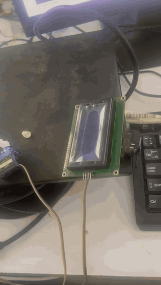
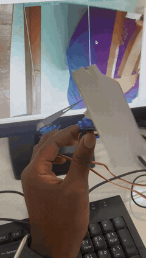
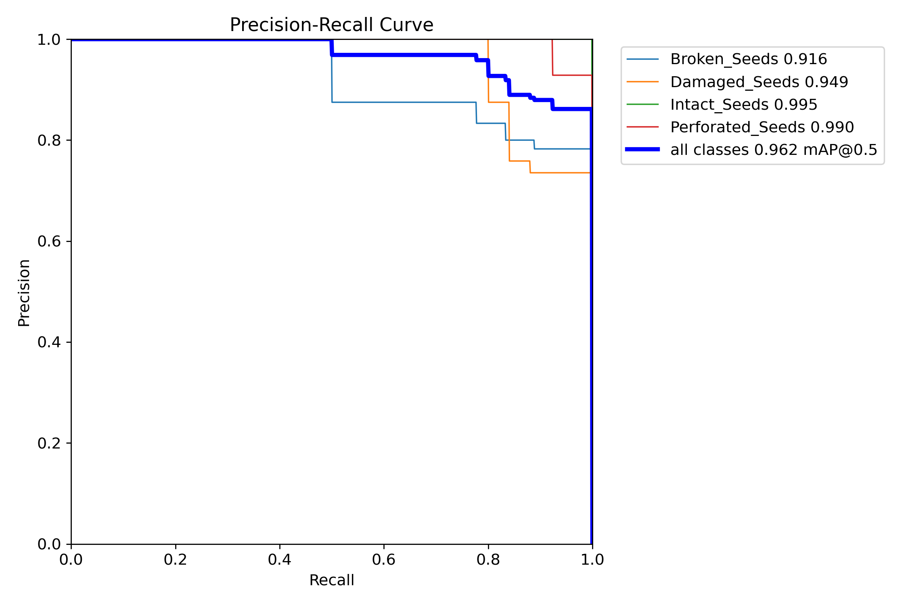
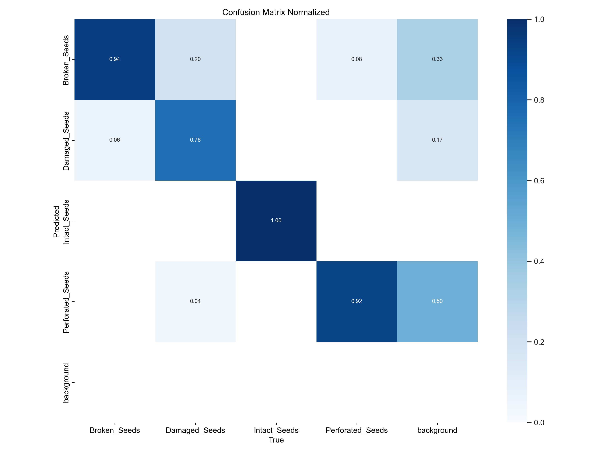
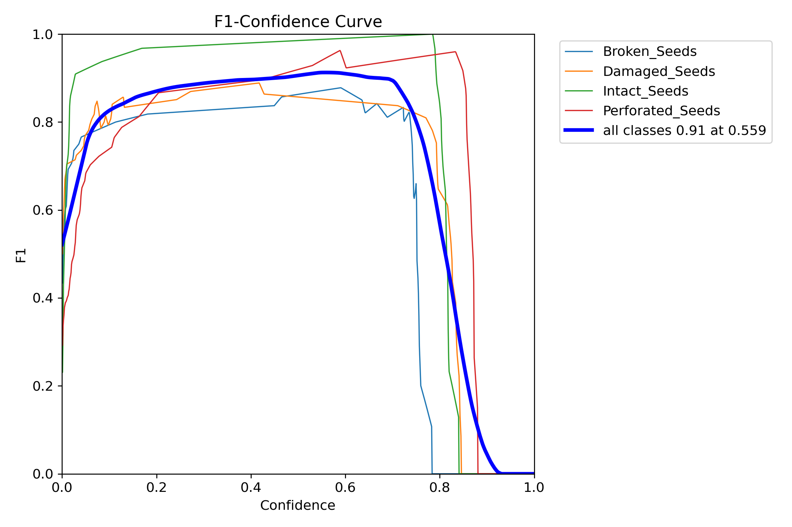
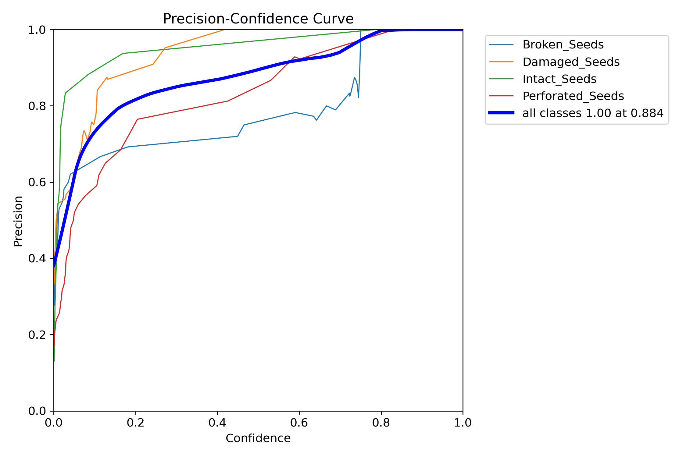
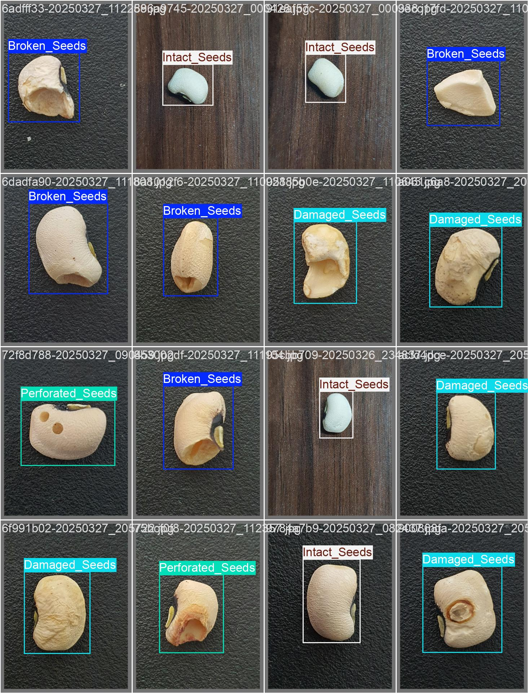
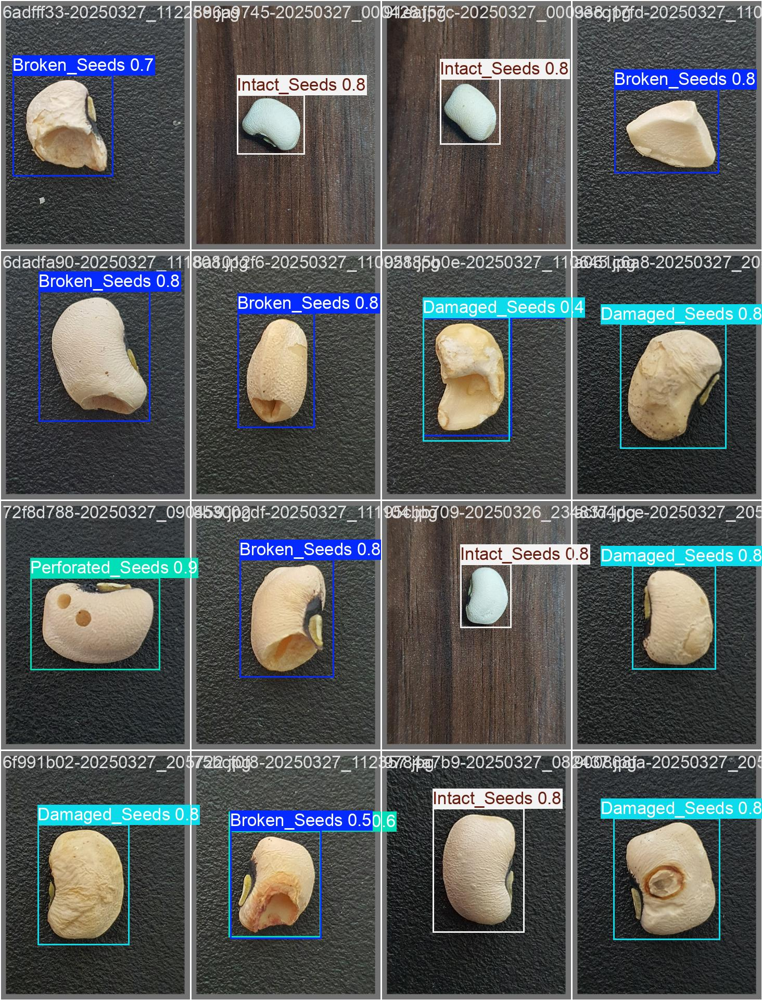
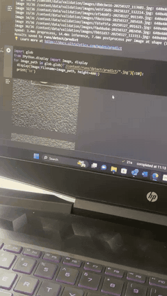
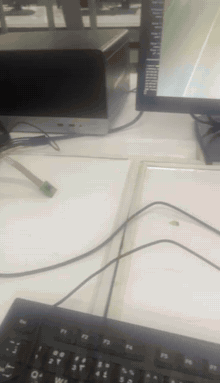

# Cowpea Seed Quality Detection & Automated Sorting with YOLO on Raspberry Pi 5

A computer-vision system that inspects individual cowpea (black-eyed pea) seeds, classifies them into four quality grades with a custom-trained YOLO model, and **physically sorts them** with servo motors on a Raspberry Pi 5. All inference runs on the device itself.

<p align="center">
  
  &nbsp;
  
</p>

| Class | What it looks like |
|---|---|
| `Intact_Seeds` | Whole, smooth seed coat, no visible defects |
| `Broken_Seeds` | Seed split or with a large piece missing |
| `Damaged_Seeds` | Wrinkled, discoloured, mouldy or abraded seed coat |
| `Perforated_Seeds` | Round exit holes left by storage pests such as the cowpea weevil |

---

## Results

Validation set: 36 images. Plots are in [`results/`](results/).

| Metric | Value |
|---|---|
| **mAP@0.5 (all classes)** | **0.962** |
| Best F1 (all classes) | 0.91 at confidence 0.559 |
| Precision = 1.00 | at confidence ≥ 0.884 |

**Per-class AP@0.5 and recall** (recall from the normalised confusion matrix):

| Class | AP@0.5 | Recall | Main confusion |
|---|---|---|---|
| Intact_Seeds | 0.995 | 1.00 | — |
| Perforated_Seeds | 0.990 | 0.92 | 8% → Broken |
| Damaged_Seeds | 0.949 | 0.76 | 20% → Broken, 4% → Perforated |
| Broken_Seeds | 0.916 | 0.94 | 6% → Damaged |

<p align="center">
  
  
</p>
<p align="center">
  
  
</p>

**Ground truth (left) vs. predictions (right), validation batch 1:**

<p align="center">
  
  
</p>

### What the numbers say
- **Intact seeds are never missed or mislabelled.** For a sorter this matters most: good seed is not thrown away.
- **Damaged ↔ Broken is the hardest boundary.** A seed with heavy surface damage and a chipped edge fits both labels, and the annotations are not always consistent either. Two of these cases are visible in the validation grids. Clearer labelling rules and more examples of these borderline seeds are the next step.
- **Background false positives** mostly come from duplicate boxes on one seed (e.g. `Broken 0.5` + `Perforated 0.6` on the same seed). The sorter keeps only the single most confident box per frame, which removes most of them.
- The sorter's confidence threshold is set to **0.56**, the best-F1 point.

---

## Project timeline

| Date | Milestone | Demo |
|---|---|---|
| May 2025 | Model trained in Google Colab and checked on the validation set | [video](media/videos/01_colab_validation_predictions.mp4) |
| Jun 2025 | Model deployed to Raspberry Pi 5 + Pi Camera for live detection, with FPS overlay | [video](media/videos/02_raspberry_pi_live_detection.mp4) |
| Jul 2025 | Full sorting rig: feeder servo, sorting servo and 16×2 LCD driven by detections | [video](media/videos/03_servo_sorting_rig.mp4) |
| Aug 2025 | Sorting gate actuated by class: a `Perforated_Seeds` detection triggers the reject flap | [video](media/videos/04_sorting_gate_actuation.mp4) |

<p align="center">
  
  &nbsp;
  
</p>

---

## How it works

```
 ┌────────────┐   push   ┌──────────────┐  frame  ┌──────────────────┐  class  ┌──────────────┐
 │ Feeder     │ ───────► │ Pi Camera    │ ──────► │ YOLO (NCNN, CPU) │ ──────► │ Sorting      │──► bins
 │ servo      │          │ inspection   │         │ on Raspberry Pi 5│         │ gate servo   │
 └────────────┘          └──────────────┘         └────────┬─────────┘         └──────────────┘
                                                           │ label + confidence
                                                           ▼
                                                    16×2 LCD + CSV log
```

1. The **feeder servo** pushes one seed into the camera's view.
2. The **YOLO model** classifies it. Only the single most confident box is kept.
3. The **sorting servo** turns the gate to the bin for that class (Intact → 90°).
4. The class and confidence appear on the **LCD** and are written to `sort_log.csv`.
5. Both servos reset and the next seed is fed in.

### Hardware

| Component | Role |
|---|---|
| Raspberry Pi 5 | Runs inference and controls all I/O |
| Raspberry Pi Camera Module (CSI ribbon) | Captures each seed |
| 2 × SG90 micro servo | Feeder arm + sorting gate |
| 16×2 character LCD (I²C backpack) | Shows class and confidence |
| Card/foam sorting chute | Steers seeds into bins |

The default pins (feeder = GPIO18, sorter = GPIO13), servo angles and LCD address are all in the `CONFIG` block at the top of [`rpi/seed_sorter.py`](rpi/seed_sorter.py). Power the servos from a separate 5 V supply that shares ground with the Pi.

---

## Repository layout

```
├── notebooks/Train_YOLO_Models.ipynb   # Colab training notebook
├── data/
│   ├── data.yaml                        # Ultralytics dataset config (4 classes)
│   └── classes.txt                      # label map
├── models/                              # put seed_model.pt here (see models/README.md)
├── rpi/
│   ├── seed_sorter.py                   # full feed → detect → sort loop with servos + LCD
│   ├── detect_live.py                   # live camera detection with FPS / object count
│   └── requirements-pi.txt
├── scripts/
│   ├── export_ncnn.py                   # .pt → NCNN for fast Pi inference
│   └── predict_images.py                # batch prediction + per-class tally
├── results/
│   ├── plots/                           # PR, F1, P, R curves, confusion matrix
│   └── val_batches/                     # validation labels vs. predictions
└── media/
    ├── videos/                          # full demo clips
    └── gifs/                            # short previews used in this README
```

---

## Reproduce it

### 1. Train (Google Colab)
1. Label seed images in [Label Studio](https://labelstud.io/) and export in YOLO format (`images/`, `labels/`, `classes.txt`), zipped as `data.zip`.
2. Open [`notebooks/Train_YOLO_Models.ipynb`](notebooks/Train_YOLO_Models.ipynb) in Colab with a GPU runtime. Upload `data.zip` and skip the cell that downloads the example candy dataset.
3. Run the cells. The notebook splits the data 90/10 into train/validation, writes `data.yaml` and trains:
   ```bash
   yolo detect train data=/content/data.yaml model=yolo11s.pt epochs=60 imgsz=640
   ```
4. Download `runs/detect/train/weights/best.pt` and save it as `models/seed_model.pt`.

### 2. Run on a PC
```bash
pip install -r requirements.txt
python scripts/predict_images.py --model models/seed_model.pt --source path/to/seed_images
python rpi/detect_live.py --model models/seed_model.pt --source usb0
python rpi/seed_sorter.py --model models/seed_model.pt --source usb0 --dry-run --show
```

### 3. Deploy on Raspberry Pi 5
```bash
sudo apt install -y python3-picamera2 python3-lgpio
python3 -m venv --system-site-packages venv && source venv/bin/activate
pip install -r rpi/requirements-pi.txt

python scripts/export_ncnn.py --weights models/seed_model.pt     # → models/seed_model_ncnn_model/
python rpi/detect_live.py --model models/seed_model_ncnn_model    # check the camera + model
python rpi/seed_sorter.py --model models/seed_model_ncnn_model --show
```
Enable I²C for the LCD with `sudo raspi-config` → Interface Options → I2C.

---

## Next steps
- Collect more borderline Damaged/Broken seeds and write explicit labelling rules for them
- Train at `imgsz=320/416` and compare the FPS/accuracy trade-off on the Pi
- Use a uniform background and diffuse lighting inside the inspection chamber to reduce glare (visible in the July demo)
- Add a conveyor or vibratory feeder to increase throughput, and measure seeds per minute
- Add a third bin so Damaged and Perforated seeds go to different places

## Acknowledgements
- Training notebook based on [Train and Deploy YOLO Models](https://github.com/EdjeElectronics/Train-and-Deploy-YOLO-Models) by Evan Juras (EJ Technology Consultants)
- [Ultralytics YOLO](https://docs.ultralytics.com/)

## Author
**Jeffery Owusu Cobbold**, Engineering Physics, University of Cape Coast · Accra, Ghana
